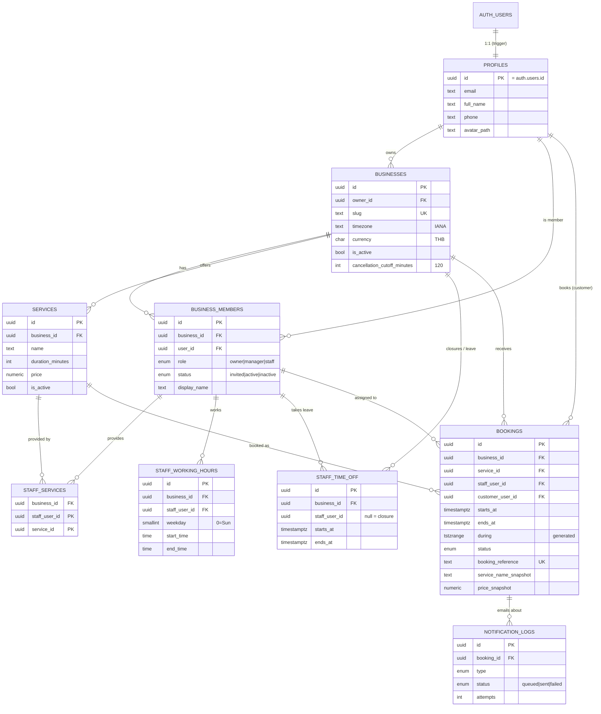

# BookFlow – Database Documentation

PostgreSQL on Supabase. Source of truth: `supabase/migrations/`. Tests: `supabase/tests/database/` (pgTAP) and `tests/integration/`.

| Migration | Contents |
|---|---|
| `…0100_extensions_and_types` | `btree_gist`, `private` schema, enum types, `timerange`, shared helpers |
| `…0200_tables` | 9 tables, constraints, indexes, `updated_at` triggers |
| `…0300_integrity_triggers` | profile on signup, owner membership, member-role guard, business guard |
| `…0400_rls` | RLS helpers, policies, table/column privileges |
| `…0500_booking_functions` | `create_booking`, `reschedule_booking`, `cancel_booking`, `update_booking_status` |
| `…0600_storage` | image buckets and Storage policies |

Never edit a migration that has been applied (locally by a teammate, or in production). Add a new one: `npx supabase migration new <name>`.

---

## Entity Relationship Diagram



**Composite foreign keys.** `staff_services`, `staff_working_hours`, `staff_time_off` and `bookings` reference `services (business_id, id)` and `business_members (business_id, user_id)`. A row can therefore never combine a service or staff member from one business with another business.

**Delete behaviour.** Businesses, services and members used by bookings cannot be deleted (`on delete restrict`). They are deactivated instead (`is_active = false`, `status = 'inactive'`), so booking history stays intact.

---

## Tables

| Table | Purpose | Key rules |
|---|---|---|
| `profiles` | One per Auth user, created by trigger | Only `full_name`, `phone`, `avatar_path` are user-editable |
| `businesses` | A business on the platform | Unique slug (`a-z0-9-`, 3–60), valid IANA timezone, 3-letter currency, cutoff 0–43 200 min (30 days) |
| `business_members` | Per-business roles | One owner per business; `(business_id, user_id)` unique |
| `services` | What a business sells | Duration 5–480 min in steps of 5; price ≥ 0 |
| `staff_services` | Who offers what | Same-business enforced by composite FKs |
| `staff_working_hours` | Weekly hours, local time | `end > start`; `24:00` allowed; intervals cannot overlap (split shifts OK) |
| `staff_time_off` | Leave and closures | `staff_user_id` null = whole business closed |
| `bookings` | Appointments | Written only by functions; no overlapping `pending`/`confirmed` rows per staff member |
| `notification_logs` | Email attempts | Server writes only; `attempts` + `status` support a retry job |

### Double-booking protection

```sql
constraint bookings_no_overlap exclude using gist (
  staff_user_id with =,
  during with &&            -- tstzrange(starts_at, ends_at, '[)')
) where (status in ('pending', 'confirmed'))
```

* It is enforced by PostgreSQL itself, so it also holds under concurrent requests. The second transaction waits for the first, then fails with `23P01`.
* `[)` ranges mean back-to-back bookings (10:00–11:00 and 11:00–12:00) are allowed.
* Cancelled, completed and no-show rows are ignored, so cancelling frees the slot immediately.
* It is not scoped to one business. A person who works at two businesses cannot be double-booked across them.

---

## Roles and access (RLS)

| | Anonymous | Customer (own data) | Staff | Manager | Owner |
|---|---|---|---|---|---|
| Active businesses, services, staff list | read | read | read | read | read |
| Inactive business / services | – | – | read own business | read | read |
| Business info | – | create own | – | update | update + (de)activate |
| Services, staff ↔ service links, working hours | – | – | read | write | write |
| Members | – | – | edit own bio/photo | add/edit **staff** | add/edit staff **and managers** |
| Time off | – | – | read; write **own leave** | write (incl. closures) | write |
| Bookings | – | read own; create/cancel/reschedule via functions | read assigned; status, reschedule, cancel | read all; all actions | read all; all actions |
| Customer profiles | – | own | customers of own bookings | members + customers of the business | same as manager |
| Notification logs | – | – | – | read | read |

Defence in depth:
1. **Privileges.** `bookings` and `notification_logs` have no INSERT/UPDATE/DELETE for clients. `profiles.email` and `businesses.owner_id` are not updatable. TRUNCATE is revoked.
2. **RLS policies** pick rows. Helpers in the `private` schema (`has_business_role`, `can_view_profile`) are `SECURITY DEFINER`, which avoids recursive policies. The `private` schema is not exposed by the Data API.
3. **Triggers** restrict which changes are allowed. Owners cannot be demoted or removed, managers cannot touch managers, staff can only edit their display fields, and ownership cannot be transferred.

The service-role (secret) key bypasses all of this. It is only used server-side (`src/lib/supabase/admin.ts`, seed script, integration tests).

---

## Booking functions

All are `SECURITY DEFINER`, run in a single transaction, and take the customer from `auth.uid()`. Price, end time, currency and reference are never taken from the client.

| Function | Who | Notes |
|---|---|---|
| `create_booking(p_service_id, p_starts_at, p_staff_user_id = null, p_customer_note = null)` | logged-in users | `p_staff_user_id = null` means **any available staff**: picks the eligible free staff member with the fewest bookings that day |
| `reschedule_booking(p_booking_id, p_new_starts_at, p_new_staff_user_id = null)` | customer, assigned staff, owner/manager | Same checks as create; keeps the original duration; staff cannot reassign to a colleague |
| `cancel_booking(p_booking_id, p_reason = null)` | customer, assigned staff, owner/manager | Customers are blocked inside the business's cutoff |
| `update_booking_status(p_booking_id, p_status)` | assigned staff, owner/manager | `pending→confirmed`; `confirmed→completed/no_show` after start; corrections between those |

Checks run in this order: logged in → service exists and active → business active → note length → start in the future, ≤ 180 days ahead, on the **30-minute local grid** → staff active and offers the service → inside one working interval (local time, DST-safe) → no time off/closure → no overlapping booking → insert (the exclusion constraint is the final guard).

Calling from the app (Phase 8):

```ts
const { data, error } = await supabase.rpc("create_booking", {
  p_service_id: serviceId,
  p_starts_at: startsAtIso,
  p_staff_user_id: staffId ?? undefined,
});
if (error) {
  const mapped = mapDbError(error);   // src/lib/api/db-errors.ts
  return fail(mapped.code, mapped.message);
}
```

### Error codes

| SQLSTATE | Reason | HTTP |
|---|---|---|
| BF001 | not_authenticated | 401 |
| BF002 | service_unavailable | 404 |
| BF003 | business_inactive | 422 |
| BF004 | staff_not_eligible | 422 |
| BF005 | start_in_past | 422 |
| BF006 | start_not_on_grid | 422 |
| BF007 | outside_working_hours | 422 |
| BF008 | staff_unavailable (leave / closure) | 422 |
| BF009, 23P01 | slot_taken (refresh slots) | 409 |
| BF010 | booking_not_found | 404 |
| BF011 | forbidden | 403 |
| BF012 | cutoff_passed | 422 |
| BF013 | invalid_status | 422 |
| BF014 | too_far_ahead | 422 |
| BF015 | invalid_input | 400 |
| 42501 | permission denied / RLS | 403 |

---

## Storage

| Bucket | Path | Who can upload |
|---|---|---|
| `business-logos` | `{business_id}/{file}` | owner, manager |
| `service-images` | `{business_id}/{service_id}/{file}` | owner, manager (service must belong to the business) |
| `staff-avatars` | `{business_id}/{user_id}/{file}` | owner, manager, or that staff member |
| `avatars` | `{user_id}/{file}` | the user |

All four are public-read (shown on public pages), 2 MB max, JPEG/PNG/WebP only. Size and type are enforced by the Storage server from the bucket settings, not only in the browser.

---

## Testing

```bash
npm run db:reset          # rebuild the local DB from migrations
npm run db:test           # pgTAP: 106 tests (schema, RLS, booking rules, storage)
npm run test:integration  # Vitest: concurrent booking from two real sessions
npm run db:lint           # Supabase's SQL linter
```
